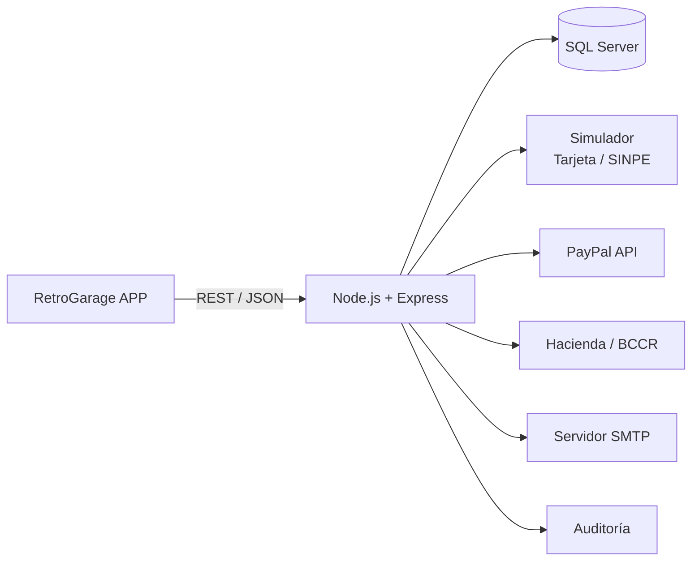

# RetroGarage APIs

API REST del sistema RetroGarage, una solución académica para administrar clientes, vehículos, citas, servicios, inventario, usuarios y pagos de un taller mecánico. El backend está construido con Node.js y Express, utiliza SQL Server y concentra las integraciones con PayPal, correo y tipo de cambio.

> **Estado:** prototipo académico funcional. La configuración de despliegue está preparada para Render y SQL Server externo, pero la API no debe utilizar datos reales hasta implementar sesiones firmadas y autorización completa por usuario y rol.

[](https://nodejs.org/)
[](https://expressjs.com/)
[](https://www.microsoft.com/sql-server)

## Funcionalidades principales

- CRUD de clientes, vehículos, citas, categorías, servicios, productos y usuarios.
- Inicio de sesión con segundo factor, recuperación de contraseña y envío por SMTP.
- Pagos locales mediante tarjeta y SINPE Móvil simulados.
- Creación, captura y cancelación de órdenes mediante PayPal Orders v2 en Sandbox.
- Consulta y caché del tipo de cambio de Hacienda/BCCR para referencia informativa.
- Registro atómico de pagos, facturas, movimientos de inventario y estado de citas.
- Auditoría de operaciones con identificadores de solicitud.
- Cifrado de identificaciones, correos y teléfonos almacenados.
- CORS por lista permitida, Helmet, límites de solicitudes y validación de entorno.
- Endpoints de salud y disponibilidad para despliegues administrados.

## Tecnologías

- **Runtime:** Node.js 24 y CommonJS.
- **API:** Express 5.
- **Base de datos:** SQL Server mediante `mssql` y consultas parametrizadas.
- **Seguridad HTTP:** Helmet, CORS y `express-rate-limit`.
- **Integraciones:** PayPal Orders v2, Nodemailer y API de tipo de cambio.
- **Pruebas:** runner nativo `node:test`.
- **Despliegue:** Blueprint de Render y SQL Server externo/Plesk.

## Arquitectura



La descripción completa de los componentes está en [`docs/DIAGRAMA_ARQUITECTURA.md`](docs/DIAGRAMA_ARQUITECTURA.md).

## Requisitos

- Node.js `>=24 <25` y npm.
- SQL Server accesible por TCP.
- Credenciales SMTP para probar recuperación de contraseña.
- Cuenta de PayPal Developer con credenciales Sandbox para probar PayPal.

## Instalación local

```bash
git clone https://github.com/sebas1-1/RetroGarageAPIs.git
cd RetroGarageAPIs
npm ci
```

En PowerShell, crea el archivo local de entorno:

```powershell
Copy-Item .env.example .env
```

Completa como mínimo la conexión a SQL Server:

```env
NODE_ENV=development
PORT=3001
DB_SERVER=localhost
DB_DATABASE=RetroGarage
DB_USER=TU_USUARIO_SQL
DB_PASSWORD=TU_CONTRASENA_SQL
DB_PORT=1433
DB_ENCRYPT=false
DB_TRUST_SERVER_CERTIFICATE=true
```

Todas las variables, incluidos SMTP, PayPal, CORS, cifrado y tipo de cambio, están documentadas en [`.env.example`](.env.example).

### Preparar la base de datos

Para una instalación nueva y portable de SQL Server:

1. Ejecuta `RetroGarage_completo.sql` para crear la base y el esquema principal.
2. Ejecuta `DatosIniciales.sql` para cargar roles, categorías, productos y servicios de demostración.
3. Ejecuta `seed_divisiones_administrativas.sql` si necesitas la jerarquía geográfica de Costa Rica.
4. Aplica, en orden, las migraciones `005` a `008` de la carpeta [`migrations/`](migrations/).

`BASEDATOSCOMPLETA.sql` es una exportación completa ligada a una instalación concreta de SQL Server; puede requerir ajustar rutas y nivel de compatibilidad antes de ejecutarse en otra máquina.

### Iniciar la API

```bash
npm start
```

Comprobaciones rápidas:

```text
GET http://localhost:3001/health
GET http://localhost:3001/ready
```

- `/health` confirma que el proceso HTTP está activo.
- `/ready` comprueba que SQL Server responde.

## Rutas principales

| Ruta base | Responsabilidad |
| --- | --- |
| `/api/usuarios` | Usuarios, roles, login, OTP y recuperación. |
| `/api/clientes` | Gestión de clientes. |
| `/api/autos` | Vehículos asociados a clientes. |
| `/api/citas` | Agenda, edición y estados de citas. |
| `/api/servicios` | Catálogo de servicios. |
| `/api/categorias` | Categorías de servicios y productos. |
| `/api/productos` | Inventario y disponibilidad. |
| `/api/pagos` | Métodos, pagos, facturas y tipo de cambio. |
| `/api/pagos/paypal` | Crear, capturar y cancelar órdenes PayPal. |
| `/api/banco-simulado` | Validación de tarjeta y SINPE Móvil simulados. |
| `/api/geografia` | Países, provincias, cantones y distritos. |

Las rutas responden JSON. Los errores incluyen `request_id` para facilitar su seguimiento.

## Pruebas y validación

```bash
npm test
npm run check
```

Las pruebas cubren configuración, cifrado, simulador bancario, PayPal y el servicio de tipo de cambio. `npm run check` valida la sintaxis de los archivos críticos y de la herramienta de rotación de claves.

## Documentación técnica

- [Arquitectura del sistema](docs/DIAGRAMA_ARQUITECTURA.md)
- [Despliegue en Render con SQL Server/Plesk](docs/DESPLIEGUE_RENDER_PLESK.md)
- [Integración PayPal Sandbox](docs/PAYPAL_SANDBOX.md)
- [Pasarela simulada de Tarjeta y SINPE](docs/PASARELA_SIMULADA.md)
- [Tipo de cambio de Hacienda/BCCR](docs/TIPO_CAMBIO_HACIENDA.md)

## Seguridad y limitaciones

- No subas `.env`, contraseñas, claves de cifrado ni credenciales PayPal/SMTP. El repositorio solo debe conservar `.env.example`.
- En producción, `DATA_ENCRYPTION_KEY` debe ser aleatoria, estable y tener al menos 32 caracteres.
- PayPal permanece en `sandbox` hasta completar pruebas, conciliación y webhooks para un entorno real.
- La API utiliza actualmente `x-user-id` como contexto de auditoría, pero no valida un token de sesión firmado en cada ruta. CORS, Helmet y rate limiting no reemplazan autenticación y autorización.
- Antes de usar datos reales deben implementarse sesiones firmadas, autorización por rol, rotación de credenciales previamente expuestas y pruebas de seguridad.

## Despliegue

El archivo [`render.yaml`](render.yaml) define un Web Service de Render con `/ready` como health check. Consulta la [guía de despliegue](docs/DESPLIEGUE_RENDER_PLESK.md) antes de configurar secretos o conectar una base remota.

## Proyecto relacionado

- [RetroGarageAPP](https://github.com/sebas1-1/RetroGarageAPP): aplicación web/móvil construida con Expo, React Native y TypeScript.

## Autor

Desarrollado por [Pedro Sebastián Navarro](https://www.linkedin.com/in/pedro-sebastian-navarro) — [GitHub](https://github.com/sebas1-1).
